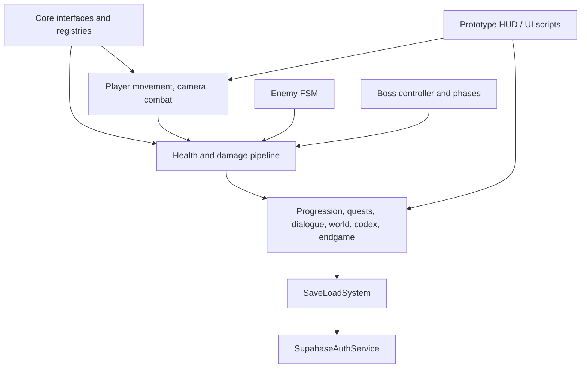
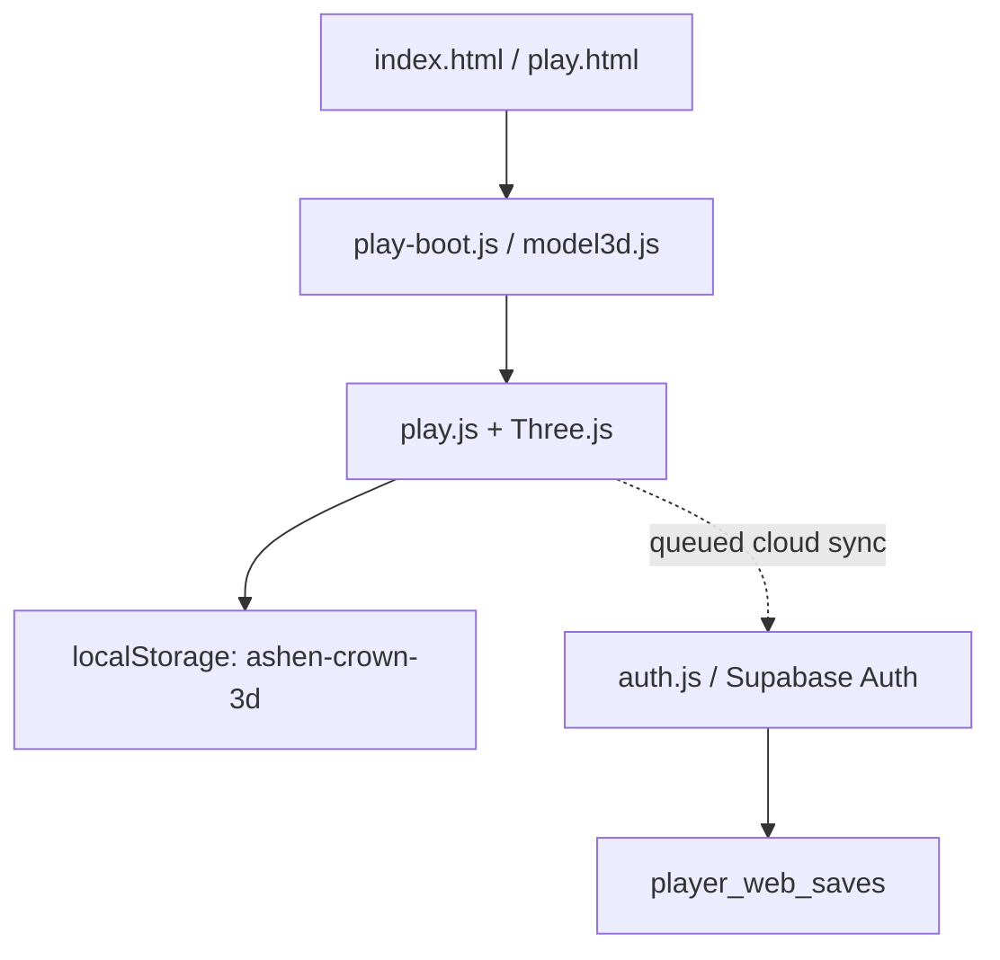

# Architecture (source-derived)

## Repository products

- **Unity C# source** in `Assets/Scripts/`, targeting Unity 2021.3 LTS and the legacy Input Manager.
- **Browser story demo** in the repository root, using a Three.js ES module loaded from the allow-listed `dist/vendor/` output first, with pinned CDN fallback paths.
- **Supabase** migrations and browser account/cloud-save integration under `supabase/` and `auth.js`.
- **Vercel** serves only `dist/`; `tools/build-web.mjs` controls the deployment allow-list.

The Unity runtime currently compiles conceptually as one assembly, `AshenCrown.Runtime`, to avoid making unverified assembly dependency assumptions. `Assets/Tests/EditMode/AshenCrown.Tests.EditMode.asmdef` references it. A future modular split requires a dependency graph first.

## Unity runtime modules

**Caveat:** this diagram is conceptual and does not claim compile-tested assembly isolation. Most game services are bootstrapped by `AshenCrownSystemsBootstrap` as components and accessed through `X.Instance`. `GameplayEventBridge` still polls scene objects every second to bind player/boss events; event-driven registries are backlog work.

## Web runtime/save/auth flow

Public browser contracts to preserve: `localStorage['ashen-crown-3d']`, save version 5, `ashen:game-ready`, `ashen:game-init-error`, `window.ASHEN_CAMPAIGN`, and `window.AshenAuth.queueSave`.

## Security boundary

- Browser cloud save rows use RLS based on `auth.uid() = user_id` in migration 002; that migration is source code and has not been applied/verified against the actual Supabase project by this pass.
- Unity cloud save uses the separate `player_saves` table from migration 001.
- Client save state is user-controlled. Do not treat client-reported progression or currency as authoritative for competitive rankings, trading, purchases, or real-money rewards.
- Existing CSP is retained; changes to allowed script/connect origins must be justified and tested.
